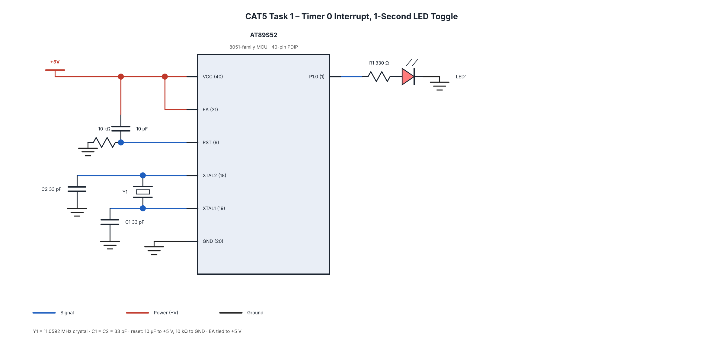

# CAT5 – Hardware Timer and Interrupt-Based Timing

## EXP
Continuous Lab Evaluation – 5 (TASK A)

## DATE
10/08/2026 (Week 4)

## NAME OF EXP
Hardware Timer Interrupt-Based LED Control and LED Fading Using Software PWM

## HARDWARE SETUP / PLATFORM
- **Microcontroller:** AT89S52 (8051)
- **Crystal Frequency:** 11.0592 MHz
- **Programming Language:** Embedded C
- **IDE / Compiler:** Keil µVision – Keil C51
- **Hardware:** AT89S52 Development Board, LED and Oscilloscope
- **Debugging Tool:** Multimeter
- **Timer:** Timer 0
- **Programming Method:** Register-level programming using hardware timer interrupts
- **Restrictions:** No Arduino APIs, HAL libraries, or RTOS services.

## TASK NO

### Task 1 – Timer 0 Interrupt and 1-Second LED Control

**Problem Statement:**

Configure Timer 0 to generate periodic interrupts. Use the timer interrupt as a software time base to toggle an LED every 1 second without using software delay loops for timing.

**Core Logic:**
1. Configure Timer 0 in Mode 1 (16-bit timer mode).
2. Load the timer registers with the required initial value.
3. Enable Timer 0 interrupt and global interrupt.
4. Reload the timer inside the interrupt service routine.
5. Maintain a software counter to track elapsed time.
6. Toggle the LED whenever the counter reaches 1 second.

**Timer Calculation:**

For a classic 12-clock 8051 with an 11.0592 MHz crystal:

- Machine cycle = 12 / 11.0592 MHz ≈ 1.085 µs
- Timer counts for 1 ms ≈ 922
- Timer preload = 65536 − 922 = 64614 = FC66H
- TH0 = 0xFC
- TL0 = 0x66

### Task 2 – LED Fading Using Software PWM

**Problem Statement:**

Use Timer 0 interrupts to generate a software PWM signal. Gradually vary the LED duty cycle from 0% to 100% and back to 0% to produce a visible fading effect.

**Core Logic:**
1. Generate periodic interrupts using Timer 0.
2. Divide each PWM period into multiple time slots.
3. Compare the PWM counter with the duty-cycle value.
4. Turn the LED ON or OFF based on the comparison.
5. Increase the duty cycle gradually from 0% to 100%.
6. Decrease the duty cycle gradually from 100% to 0%.
7. Repeat the fading sequence continuously.

**Duty-Cycle Sequence:**

0% → 10% → 20% → 30% → 40% → 50% → 60% → 70% → 80% → 90% → 100% → 90% → ... → 0%

**Suggested PWM Frequency:** 500 Hz – 1 kHz

## CIRCUIT DIAGRAM

The circuit diagram illustrates the AT89S52 microcontroller connected to an LED through P1.0 for timer interrupt-based LED control and PWM fading.

## CORE LOGIC / PSEUDOCODE / CODE BASE

### General P