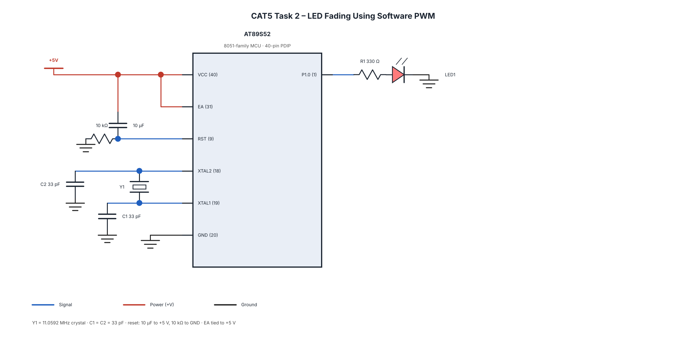

# CAT5 – Hardware Timer and Interrupt-Based Timing

## EXP
Continuous Lab Evaluation – 5 (TASK B)

## DATE
10/08/2026 (Week 4)

## NAME OF EXP
Variable-Frequency Square-Wave Generation and Stepper Motor Speed and Direction Control

## HARDWARE SETUP / PLATFORM
- **Microcontroller:** AT89S52 (8051)
- **Crystal Frequency:** 11.0592 MHz
- **Programming Language:** Embedded C
- **IDE / Compiler:** Keil µVision – Keil C51
- **Hardware:** AT89S52 Development Board, Oscilloscope, Stepper Motor (optional) and Motor Driver (if used)
- **Debugging Tool:** Multimeter
- **Timer:** Timer 0
- **Programming Method:** Register-level programming using hardware timer interrupts
- **Restrictions:** No Arduino APIs, HAL libraries, or RTOS services.

## TASK NO

### Task 3 – Variable-Frequency Square-Wave Generation

**Problem Statement:**

Configure a GPIO pin as an output and use timer interrupts to generate square-wave signals at different frequencies. Measure the output frequency and duty cycle using an oscilloscope.

**Frequency Modes:**

| Mode | Frequency |
|---|---:|
| Mode 1 | 100 Hz |
| Mode 2 | 500 Hz |
| Mode 3 | 1 kHz |
| Mode 4 | 2 kHz |
| Mode 5 | 5 kHz |

**Additional Signal Types:**
1. Square Wave
2. Variable Duty-Cycle Wave
3. Pulse Train
4. Burst Signal

**Core Logic:**
1. Configure Timer 0 for periodic interrupts.
2. Toggle the output pin at the required intervals.
3. Change the timer interval or toggle count to generate different frequencies.
4. Use an oscilloscope to observe and measure the generated signals.

### Task 4 – Stepper Motor Speed and Direction Control (Optional)

**Problem Statement:**

Use timer interrupts to generate the stepping sequence for a stepper motor. Control its speed and direction by changing the stepping interval and sequence order.

**Step Sequence:**

1000 → 0100 → 0010 → 0001

**Speed Modes:**

| Speed | Time per Step |
|---|---:|
| Slow | 100 ms |
| Medium | 50 ms |
| Fast | 10 ms |

**Core Logic:**
1. Configure Timer 0 to generate periodic interrupts.
2. Maintain a software counter to track the required step interval.
3. Generate the next step when the counter reaches the selected interval.
4. Change the sequence order to control motor direction.
5. Change the interval to control motor speed.

## CIRCUIT DIAGRAM

The circuit diagram illustrates the AT89S52 output connection for variable-frequency signal generation. Stepper motor interfacing is optional and should be included only if implemented.

## CORE LOGIC / PSEUDOCODE / CODE BASE

### General Pseudocode
1. Start.
2. Initialize the required GPIO pins.
3. Configure Timer 0 for periodic interrupts.
4. Load the timer initial count.
5. Enable Timer 0 interrupt and global interrupt.
6. Start Timer 0.
7. In the timer interrupt service routine:
   - Reload the timer.
   - Update the software counter.
   - Toggle the output pin at the required interval.
   - Generate the selected signal.
   - Update the stepper motor sequence if implemented.
8. Repeat continuously.

### Code Base
- `cat5_task3_variable_frequency.c`
- `cat5_task4_stepper_motor.c` (if implemented)
- Keil project file (`.uvproj` or `.uvprojx`)
- `STARTUP.A51`, if generated/required by the project
- Compiled HEX file (`.hex`), if generated

## INFERENCE

The experiment demonstrates variable-frequency signal generation using hardware timer interrupts in the AT89S52 microcontroller. Timer-based timing is also applied to optional stepper motor speed and direction control through different stepping intervals and sequences.