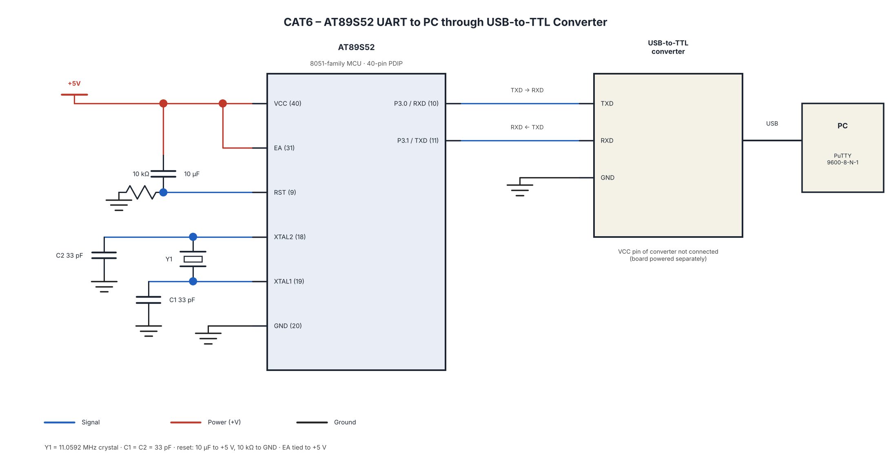

# CAT6 – UART Driver and Serial Debugging

## EXP
Continuous Lab Evaluation – 6 (TASK A)

## DATE
17/08/2026 (Week 5)

## NAME OF EXP
UART Initialization and Character Transmission

## HARDWARE SETUP / PLATFORM
- **Microcontroller:** AT89S52 (8051)
- **Crystal Frequency:** 11.0592 MHz
- **Programming Language:** Embedded C
- **IDE / Compiler:** Keil µVision – Keil C51
- **Hardware:** AT89S52 Development Board, USB-to-TTL Serial Converter and PC
- **Serial Terminal:** PuTTY
- **UART Communication:** 9600 Baud, 8 Data Bits, No Parity, 1 Stop Bit (9600-8-N-1)
- **UART Pins:**
  - TXD – P3.1
  - RXD – P3.0
- **Baud Rate Generation:** Timer 1, Mode 2 (8-bit auto-reload)
- **Restrictions:** No Arduino APIs, HAL libraries, or RTOS services.

## TASK NO

### Task A – UART Initialization and Character Transmission

**Problem Statement:**

Configure the AT89S52 UART for 8-bit asynchronous serial communication at 9600 baud, with 1 stop bit and no parity. Continuously transmit the message "Hello from 8051" to a PC terminal using PuTTY through a USB-to-TTL serial converter.

**Core Logic:**
1. Configure Timer 1 in Mode 2 for baud-rate generation.
2. Load TH1 with the required reload value.
3. Configure SCON for UART Mode 1 and enable reception.
4. Start Timer 1.
5. Transmit characters through the SBUF register.
6. Monitor the TI flag to identify transmission completion.
7. Continuously transmit the message to PuTTY.

**UART Configuration:**

| Parameter | Configuration |
|---|---|
| UART Mode | Mode 1 |
| Baud Rate | 9600 |
| Data Bits | 8 |
| Stop Bits | 1 |
| Parity | None |
| Timer | Timer 1, Mode 2 |
| TH1 | 0xFD |

## CIRCUIT DIAGRAM

The circuit diagram shows the UART communication connection between the AT89S52 microcontroller and the PC through a USB-to-TTL serial converter.

**UART Connections:**

| AT89S52 | USB-to-TTL Converter |
|---|---|
| TXD (P3.1) | RXD |
| RXD (P3.0) | TXD |
| GND | GND |

*Note: Verify the actual board schematic and USB-to-TTL voltage requirements before connecting.*

## CORE LOGIC / PSEUDOCODE / CODE BASE

### General Pseudocode
1. Start.
2. Configure Timer 1 in Mode 2.
3. Load TH1 with 0xFD.
4. Configure UART in Mode 1.
5. Start Timer 1.
6. Transmit the message "Hello from 8051" using SBUF.
7. Wait until TI becomes 1.
8. Clear the TI flag.
9. Repeat the message transmission continuously.

### Code Base
- `cat6_taskA_uart_transmit.c`
- Keil project file (`.uvproj` or `.uvprojx`), if applicable
- `STARTUP.A51`, if generated/required
- Compiled HEX file (`.hex`), if generated

## INFERENCE

The experiment demonstrates UART initialization and serial character transmission using the AT89S52 microcontroller. Timer 1 is configured in Mode 2 to generate the baud rate, and the UART transmits the message through the TXD pin. PuTTY is used to verify serial communication at 9600 baud.