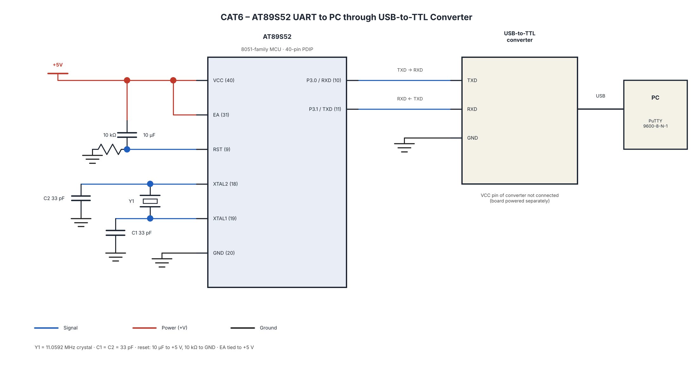

# CAT6 – UART Driver and Serial Debugging

## EXP
Continuous Lab Evaluation – 6 (TASK B)

## DATE
17/08/2026 (Week 5)

## NAME OF EXP
UART Echo Using Character Reception

## HARDWARE SETUP / PLATFORM
- **Microcontroller:** AT89S52 (8051)
- **Crystal Frequency:** 11.0592 MHz
- **Programming Language:** Embedded C
- **IDE / Compiler:** Keil µVision – Keil C51
- **Hardware:** AT89S52 Development Board, USB-to-TTL Serial Converter and PC
- **Serial Terminal:** PuTTY
- **UART Communication:** 9600 Baud, 8 Data Bits, No Parity, 1 Stop Bit (9600-8-N-1)
- **UART Pins:**
  - TXD – P3.1
  - RXD – P3.0
- **Baud Rate Generation:** Timer 1, Mode 2 (8-bit auto-reload)
- **Restrictions:** No Arduino APIs, HAL libraries, or RTOS services.

## TASK NO

### Task B – UART Echo Using Character Reception

**Problem Statement:**

Develop an interactive UART application in which every character received from PuTTY is immediately transmitted back to the PC terminal.

**Expected Output:**

If the user types:

`ABC123`

The terminal should display:

`ABC123`

**Core Logic:**
1. Initialize UART communication at 9600 baud.
2. Enable UART reception.
3. Wait for a character to arrive from PuTTY.
4. Check the RI flag to identify reception completion.
5. Read the received character from the SBUF register.
6. Clear the RI flag.
7. Transmit the same character back to PuTTY.
8. Repeat continuously.

## UART REGISTERS AND FLAGS

| Register / Flag | Purpose |
|---|---|
| SCON | Selects UART operating mode |
| SBUF | Transmits and receives serial data |
| TI | Indicates transmission completion |
| RI | Indicates reception completion |
| TMOD | Configures Timer 1 mode |
| TH1 | Stores Timer 1 reload value |
| TR1 | Starts Timer 1 |

## BAUD RATE CALCULATION

For an AT89S52 with an 11.0592 MHz crystal, using Timer 1 Mode 2 and UART Mode 1 with SMOD = 0:

- Crystal frequency = 11.0592 MHz
- Required baud rate = 9600
- Timer 1 reload value = 0xFD

## CIRCUIT DIAGRAM

The circuit diagram shows the UART transmit and receive connections between the AT89S52 microcontroller and the PC through a USB-to-TTL serial converter.

**UART Connections:**

| AT89S52 | USB-to-TTL Converter |
|---|---|
| TXD (P3.1) | RXD |
| RXD (P3.0) | TXD |
| GND | GND |

*Note: Use the actual board schematic and USB-to-TTL converter voltage requirements when preparing the circuit diagram.*

## CORE LOGIC / PSEUDOCODE / CODE BASE

### General Pseudocode
1. Start.
2. Initialize UART communication.
3. Configure Timer 1 for baud-rate generation.
4. Load TH1 with 0xFD.
5. Start Timer 1.
6. Enable UART reception.
7. Check the RI flag for received data.
8. Read the received character from SBUF.
9. Clear the RI flag.
10. Transmit the same character back through SBUF.
11. Wait for TI to become 1.
12. Clear TI and repeat continuously.

### Code Base
- `cat6_taskB_uart_echo.c`
- Keil project file (`.uvproj` or `.uvprojx`), if applicable
- `STARTUP.A51`, if generated/required
- Compiled HEX file (`.hex`), if generated

## INFERENCE

The experiment demonstrates UART-based character reception and echo communication using the AT89S52 microcontroller. The UART receives characters through the RXD pin and transmits the same characters through the TXD pin. PuTTY is used to verify the echo operation at 9600 baud.