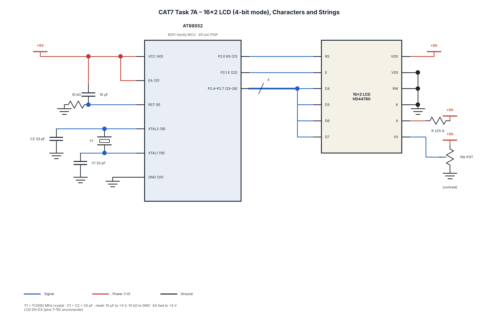

# CAT7 – 16x2 LCD Driver Development and Dynamic Display Control

## EXP
Continuous Lab Evaluation – 7 (TASK A)

## DATE
24/08/2026 (Week 6)

## NAME OF EXP
LCD Initialization and Character/String Display Using 16x2 LCD

## HARDWARE SETUP / PLATFORM
- **Microcontroller:** AT89S52 (8051)
- **LCD:** HD44780-compatible 16x2 Character LCD
- **Programming Language:** Embedded C
- **IDE / Compiler:** Keil µVision – Keil C51
- **Crystal Frequency:** 11.0592 MHz
- **Hardware:** AT89S52 Development Board and 16x2 LCD
- **Debugging Tools:** Multimeter and Digital Storage Oscilloscope (DSO)
- **LCD Interface:** 4-bit GPIO mode
- **Restrictions:** No Arduino APIs, HAL libraries, or RTOS services.

## TASK NO

### Task 7A – LCD Initialization and Character/String Display

**Problem Statement:**

Develop a 4-bit GPIO-based LCD driver for the AT89S52 using the HD44780-compatible LCD datasheet. Initialize the 16x2 LCD in 4-bit, 2-line mode and display individual characters and strings on both rows.

**Core Logic:**
1. Configure the LCD control and data pins.
2. Initialize the LCD in 4-bit mode.
3. Configure the LCD for 2-line display and 5x8 character font.
4. Implement `lcd_cmd()` to send commands.
5. Implement `lcd_data()` to send character data.
6. Implement `lcd_init()` to initialize the LCD.
7. Display individual characters and strings on both rows.

**Required Functions:**
- `lcd_init()`
- `lcd_cmd()`
- `lcd_data()`

## CIRCUIT DIAGRAM

The circuit diagram illustrates the AT89S52 interfacing with a 16x2 LCD in 4-bit GPIO mode.

**LCD Interface:**
- RS – Register Select
- RW – Read/Write
- E – Enable
- D4–D7 – 4-bit data lines
- VCC and GND – Power supply
- V0 – Contrast adjustment

*Note: Add the actual LCD circuit diagram as `circuit.png`. Connections must match the source code and board schematic.*

## CORE LOGIC / PSEUDOCODE / CODE BASE

### General Pseudocode
1. Start.
2. Initialize the LCD GPIO pins.
3. Configure the LCD in 4-bit mode.
4. Configure the LCD for 2-line display.
5. Implement LCD command and data functions.
6. Display individual characters.
7. Display strings on both LCD rows.
8. Repeat the required display operations.

### Code Base
- `cat7_task7A_lcd.c`
- Keil project file (`.uvproj` or `.uvprojx`), if applicable
- `STARTUP.A51`, if generated/required
- Compiled HEX file (`.hex`), if generated

## INFERENCE

The experiment demonstrates the development of a low-level 4-bit LCD driver using the AT89S52 microcontroller. The HD44780-compatible LCD is initialized using the required command sequence to display individual characters and strings on both rows.