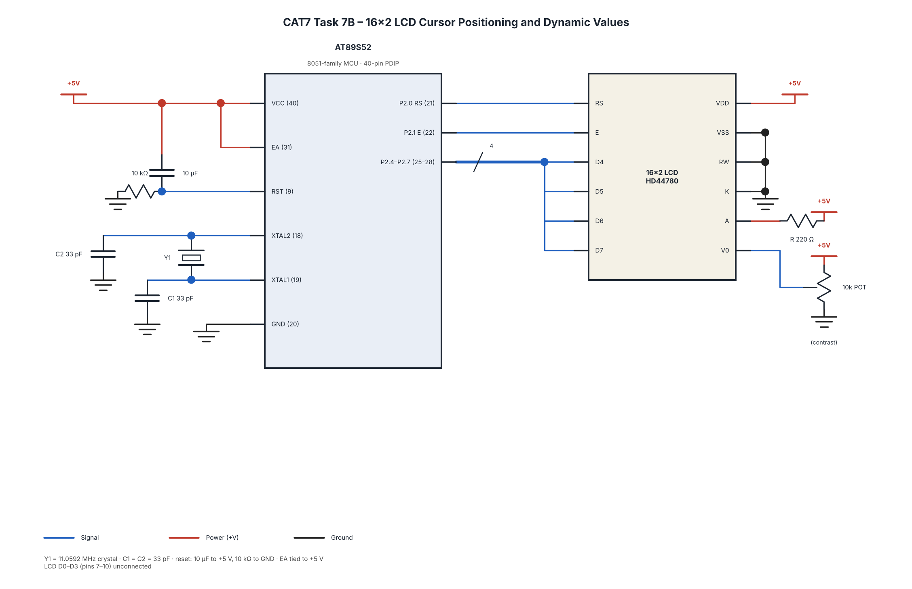

# CAT7 – 16x2 LCD Driver Development and Dynamic Display Control

## EXP
Continuous Lab Evaluation – 7 (TASK B)

## DATE
24/08/2026 (Week 6)

## NAME OF EXP
LCD Cursor Positioning and Dynamic Value Update

## HARDWARE SETUP / PLATFORM
- **Microcontroller:** AT89S52 (8051)
- **LCD:** HD44780-compatible 16x2 Character LCD
- **Programming Language:** Embedded C
- **IDE / Compiler:** Keil µVision – Keil C51
- **Crystal Frequency:** 11.0592 MHz
- **Hardware:** AT89S52 Development Board and 16x2 LCD
- **Debugging Tools:** Multimeter and Digital Storage Oscilloscope (DSO)
- **LCD Interface:** 4-bit GPIO mode
- **Restrictions:** No Arduino APIs, HAL libraries, or RTOS services.

## TASK NO

### Task 7B – Cursor Positioning and Dynamic Value Update

**Problem Statement:**

Develop LCD cursor-positioning and data-update functions to display strings and numerical values at specified positions on the 16x2 LCD.

**Core Logic:**
1. Select the required LCD row and column.
2. Set the cursor position using the corresponding DDRAM address.
3. Display strings using the LCD string function.
4. Convert numerical values into displayable characters.
5. Update the displayed values dynamically.

**Required Functions:**
- `lcd_goto(row, column)`
- `lcd_puts(string)`
- `lcd_print_number(value)`

## CIRCUIT DIAGRAM

The circuit diagram illustrates the AT89S52 interfacing with a 16x2 LCD using a 4-bit GPIO connection.

**LCD Interface:**
- RS – Register Select
- RW – Read/Write
- E – Enable
- D4–D7 – 4-bit data lines
- VCC and GND – Power supply
- V0 – Contrast adjustment

*Note: Add the actual LCD circuit diagram as `circuit.png`. Connections must match the source code and board schematic.*

## CORE LOGIC / PSEUDOCODE / CODE BASE

### General Pseudocode
1. Start.
2. Initialize the LCD.
3. Select the required LCD row and column.
4. Set the cursor using the DDRAM address.
5. Display the required string.
6. Convert numerical values into displayable characters.
7. Update the displayed values dynamically.
8. Repeat the display update process.

### Code Base
- `cat7_task7B_lcd_cursor.c`
- Keil project file (`.uvproj` or `.uvprojx`), if applicable
- `STARTUP.A51`, if generated/required
- Compiled HEX file (`.hex`), if generated

## INFERENCE

The experiment demonstrates LCD cursor positioning and dynamic data updating using the AT89S52 microcontroller. LCD functions are used to position the cursor, display strings, convert numerical values into characters, and update the displayed information.