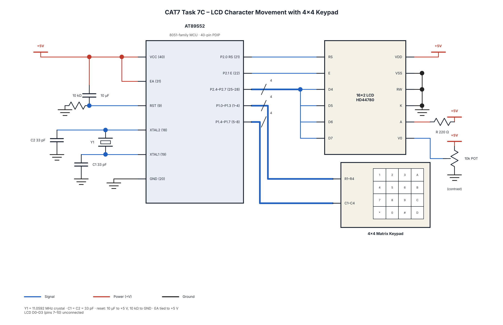

# CAT7 – 16x2 LCD Driver Development and Dynamic Display Control

## EXP
Continuous Lab Evaluation – 7 (TASK C)

## DATE
24/08/2026 (Week 6)

## NAME OF EXP
4x4 Keypad-Based Character Movement on 16x2 LCD

## HARDWARE SETUP / PLATFORM
- **Microcontroller:** AT89S52 (8051)
- **LCD:** HD44780-compatible 16x2 Character LCD
- **Keypad:** 4x4 Matrix Keypad
- **Programming Language:** Embedded C
- **IDE / Compiler:** Keil µVision – Keil C51
- **Crystal Frequency:** 11.0592 MHz
- **Hardware:** AT89S52 Development Board, 16x2 LCD and 4x4 Keypad
- **Debugging Tools:** Multimeter and Digital Storage Oscilloscope (DSO)
- **LCD Interface:** 4-bit GPIO mode
- **Restrictions:** No Arduino APIs, HAL libraries, or RTOS services.

## TASK NO

### Task 7C – 4x4 Keypad-Based Character Movement

**Problem Statement:**

Develop an interactive LCD application in which a character moves across the 16x2 LCD based on directional keys pressed on a 4x4 matrix keypad.

**Key Operations:**

| Key | Action |
|---|---|
| 1 | Move Up |
| 2 | Move Down |
| + | Move Left |
| - | Move Right |
| Q | Search |
| H | Hints |

**Core Logic:**
1. Initialize the LCD and keypad.
2. Display a character at the initial LCD position.
3. Scan the keypad to detect a key press.
4. Identify the pressed key.
5. Update the character position according to the assigned key.
6. Clear the previous character position.
7. Display the character at the new position.
8. Repeat the process to allow continuous interaction.

## CIRCUIT DIAGRAM

The circuit diagram illustrates the AT89S52 interfacing with a 16x2 LCD and a 4x4 matrix keypad for interactive character movement.

**LCD Interface:**
- RS – Register Select
- RW – Read/Write
- E – Enable
- D4–D7 – 4-bit data lines
- VCC and GND – Power supply
- V0 – Contrast adjustment

**Keypad Interface:**
- Four Row pins
- Four Column pins
- GPIO connections for keypad scanning

*Note: Add the actual LCD and keypad circuit diagram as `circuit.png`. The pin connections must match the source code and board schematic.*

## CORE LOGIC / PSEUDOCODE / CODE BASE

### General Pseudocode
1. Start.
2. Initialize the LCD and keypad GPIO pins.
3. Display the character at the initial position.
4. Scan the keypad continuously.
5. Detect and identify the pressed key.
6. Check the corresponding key operation.
7. Update the character position.
8. Clear the previous character position.
9. Display the character at the new position.
10. Repeat continuously.

### Code Base
- `cat7_task7C_keypad_lcd.c`
- Keil project file (`.uvproj` or `.uvprojx`), if applicable
- `STARTUP.A51`, if generated/required
- Compiled HEX file (`.hex`), if generated

## INFERENCE

The experiment demonstrates interactive LCD control using the AT89S52 microcontroller and a 4x4 matrix keypad. Keypad scanning is used to detect directional inputs, and the character position is updated dynamically on the 16x2 LCD. This experiment provides practical understanding of GPIO interfacing, LCD commands, keypad scanning, and Embedded C programming.