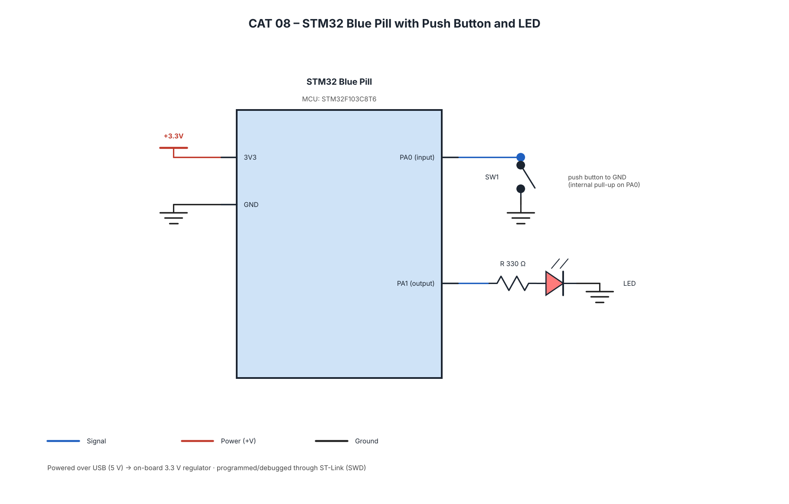

# CAT8 – STM32 GPIO Bring-Up and Switch-Controlled LED

## EXP
Continuous Lab Evaluation – 8 (TASK A)

## DATE
18/09/2026 (Week 8)

## NAME OF EXP
GPIO Input/Output – Switch-Controlled LED

## HARDWARE SETUP / PLATFORM
- **Microcontroller:** STM32 Blue Pill
- **Development Tool:** STM32CubeMX
- **IDE / Compiler:** Keil MDK
- **Programming Language:** Embedded C
- **Libraries:** STM32 HAL Libraries
- **Hardware:** Push-Button, LED, Current-Limiting Resistor, Breadboard and Jumper Wires

## TASK NO

### Task 8A – GPIO Input/Output

**Problem Statement:**

Interface a push-button and LED with the STM32. Configure GPIO pins for input and output. Turn the LED ON when the switch is pressed and turn it OFF when the switch is released.

**Core Logic:**
1. Configure the required GPIO pins for input and output.
2. Read the push-button state using `HAL_GPIO_ReadPin()`.
3. Turn the LED ON when the switch is pressed.
4. Turn the LED OFF when the switch is released.
5. Repeat continuously.

## CIRCUIT DIAGRAM

The circuit diagram illustrates the STM32 Blue Pill interfacing with a push-button and LED.

**Hardware Components:**
- STM32 Blue Pill development board
- Push-button
- LED
- Current-limiting resistor
- Breadboard and jumper wires

*Note: Add the actual hardware circuit diagram as `circuit.png`. Pin connections must match the source code.*

## CORE LOGIC / PSEUDOCODE / CODE BASE

### Core HAL Functions
- `HAL_GPIO_ReadPin()` – Read switch state.
- `HAL_GPIO_WritePin()` – Control LED.

### General Pseudocode
1. Start.
2. Initialize GPIO pins.
3. Configure the button as input.
4. Configure the LED as output.
5. Read the push-button state.
6. If the button is pressed, turn ON the LED.
7. Otherwise, turn OFF the LED.
8. Repeat continuously.

### Code Base
- `cat8_taskA_gpio.c`
- STM32CubeMX project file (`.ioc`)
- Keil project file (`.uvprojx`)
- Generated HAL files, if required

## INFERENCE

The experiment demonstrates STM32 GPIO input and output operations. The push-button state is read using the HAL library, and the LED is controlled according to the switch state.