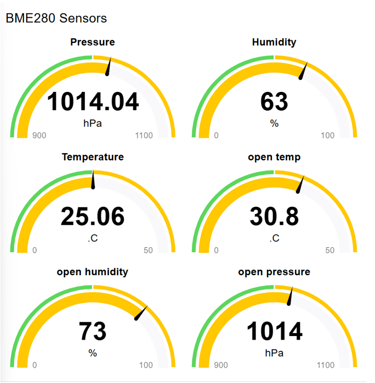
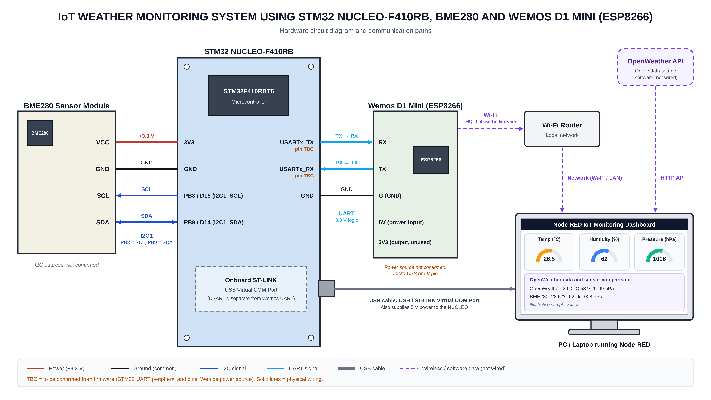

# CAT 15 – STM32-Based IoT Weather Monitoring System Using BME280

## Overview

This project implements an IoT-based weather monitoring system using the **STM32 NUCLEO-F410RB development board** and the **BME280 environmental sensor**.

The BME280 sensor measures temperature, humidity, and atmospheric pressure. The STM32 microcontroller reads the sensor data and sends it for monitoring through a Node-RED dashboard.

The project also incorporates the OpenWeather API to obtain external weather information for comparison with locally measured environmental parameters.

## Hardware Requirements

- STM32 NUCLEO-F410RB Development Board
- BME280 Environmental Sensor
- USB Cable (ST-LINK Virtual COM Port)
- Jumper Wires

## Software and Tools

- STM32CubeMX
- Keil MDK-ARM
- STM32 HAL Library
- Embedded C
- Node-RED
- Node-RED Dashboard
- OpenWeather API
- MQTT / ESP8266 integration components (where configured)

## Project Objective

To develop an IoT-based environmental monitoring system that measures real-time temperature, humidity, and atmospheric pressure using the BME280 sensor interfaced with an STM32 microcontroller and displays the collected information through a Node-RED dashboard.

## Implementation

### TASK 15A – BME280 Sensor Interfacing with STM32

**Objective:** Interface the BME280 environmental sensor with the STM32 NUCLEO-F410RB board.

**Implementation:**
- Interfaced the BME280 sensor with the STM32 board.
- Integrated the BME280 driver files (`bme280.c`, `bme280.h`, and `bme280_defs.h`).
- Configured the required peripherals using STM32CubeMX.
- Developed Embedded C code using the STM32 HAL Library.
- Acquired temperature, humidity, and pressure readings.

**Observation:** The STM32 successfully acquired environmental measurements from the BME280 sensor.

### TASK 15B – Sensor Data Transmission

**Objective:** Transmit environmental measurements for remote monitoring.

**Implementation:**
- Used the STM32 serial communication interface.
- Utilized the ST-LINK USB Virtual COM Port for serial communication and monitoring.
- Prepared sensor readings for processing and visualization in Node-RED.

**Observation:** Sensor data was successfully received and processed in the monitoring workflow.

### TASK 15C – Node-RED Dashboard Development

**Objective:** Display real-time environmental measurements using a graphical dashboard.

**Implementation:**
- Used Node-RED for data processing and visualization.
- Created dashboard gauges for temperature, humidity, and atmospheric pressure.
- Configured data flow using Function and Change nodes.
- Connected sensor data processing to dashboard components.

**Observation:** The dashboard successfully displayed the BME280 sensor readings.

### TASK 15D – OpenWeather API Integration

**Objective:** Obtain external weather information for comparison with locally measured sensor values.

**Implementation:**
- Integrated the OpenWeather API into the Node-RED flow.
- Configured an HTTP request to retrieve weather information.
- Processed the API response using Function nodes.
- Extracted temperature, humidity, and pressure parameters.
- Prepared Change nodes and a comparison Function to process the six environmental values.

**Observation:** The OpenWeather API response was successfully retrieved and processed. Automated comparison of local sensor readings and external weather parameters is ongoing.

## Node-RED Dashboard Output

The dashboard provides graphical representations of the environmental parameters measured by the BME280 sensor.

- Temperature (°C)
- Relative Humidity (%)
- Atmospheric Pressure (hPa)

### Dashboard Screenshot

*Figure 1: Node-RED dashboard displaying environmental sensor readings.*

### Node-RED Flow

*Figure 2: Node-RED flow showing sensor data processing, OpenWeather API integration, and dashboard connections.*

## Hardware Setup

The BME280 environmental sensor is interfaced with the STM32 NUCLEO-F410RB development board.

**Hardware Components:**
- NUCLEO-F410RB
- BME280 Sensor
- USB connection for programming and serial communication

## Key Concepts Demonstrated

- STM32 Microcontroller Programming
- BME280 Sensor Interfacing
- Temperature, Humidity, and Pressure Measurement
- STM32 HAL Library
- Serial Communication
- Node-RED Flow Development
- IoT Data Visualization
- HTTP Request and API Integration
- OpenWeather API
- Environmental Data Monitoring

## Conclusion

The project demonstrates an IoT-based weather monitoring system using the STM32 NUCLEO-F410RB development board and BME280 environmental sensor.

The system successfully acquires temperature, humidity, and atmospheric pressure readings and displays them through a Node-RED dashboard.

OpenWeather API integration provides external weather information and introduces the possibility of comparing locally measured environmental parameters with online weather data.

This project provides practical experience in embedded systems programming, sensor interfacing, serial communication, IoT concepts, API integration, and real-time data visualization.

## Project Information

- **Platform:** STM32 NUCLEO-F410RB
- **Sensor:** BME280
- **Programming Language:** Embedded C
- **Development Environment:** Keil MDK-ARM
- **Visualization Platform:** Node-RED